<p align="center">
  
</p>

<h1 align="center">ReportaCiudad</h1>

<p align="center">
  <strong>Santa Cruz, mirada por todos.</strong><br>
  App Android para que los vecinos de Santa Cruz de la Sierra reporten los problemas de su ciudad<br>
  —baches, basura, alumbrado, fugas de agua, incendios— con foto y ubicación, en menos de un minuto.
</p>

<p align="center">
  
  
  
  
  
  
  
</p>

<p align="center">
  <a href="#-capturas">Capturas</a> ·
  <a href="#-funcionalidades">Funcionalidades</a> ·
  <a href="#-cómo-funciona">Cómo funciona</a> ·
  <a href="#-cómo-ejecutarla">Cómo ejecutarla</a> ·
  <a href="#-hoja-de-ruta">Hoja de ruta</a>
</p>

---

## 📸 Capturas

<table>
  <tr>
    <td align="center">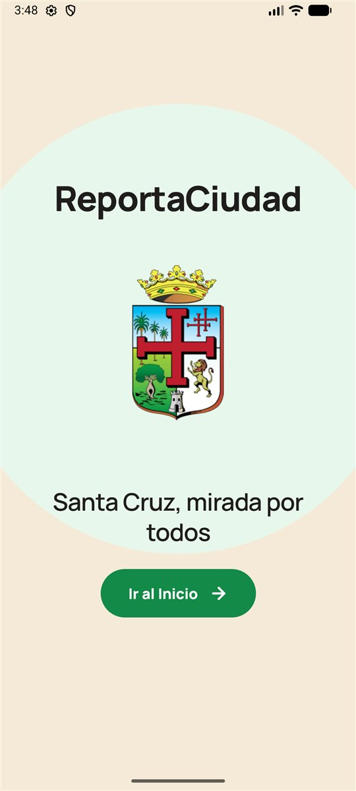<br><sub><b>Bienvenida</b></sub></td>
    <td align="center">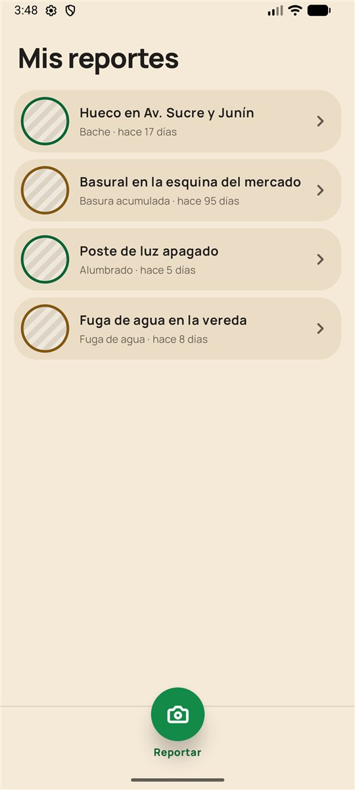<br><sub><b>Mis reportes</b></sub></td>
    <td align="center">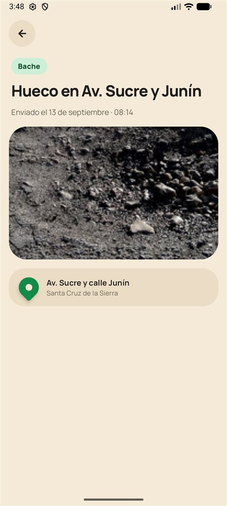<br><sub><b>Detalle del reporte</b></sub></td>
  </tr>
</table>

### Reportar un problema, en 5 pasos

<table>
  <tr>
    <td align="center">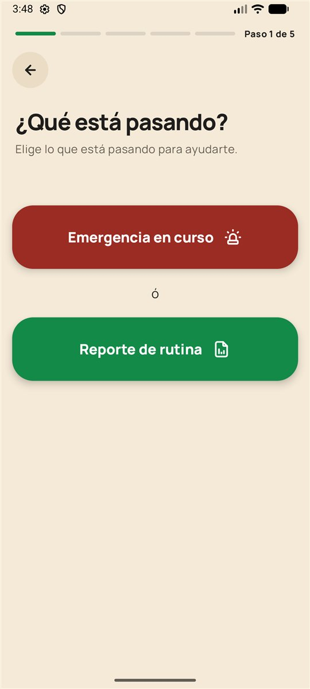<br><sub><b>1 · ¿Qué está pasando?</b></sub></td>
    <td align="center">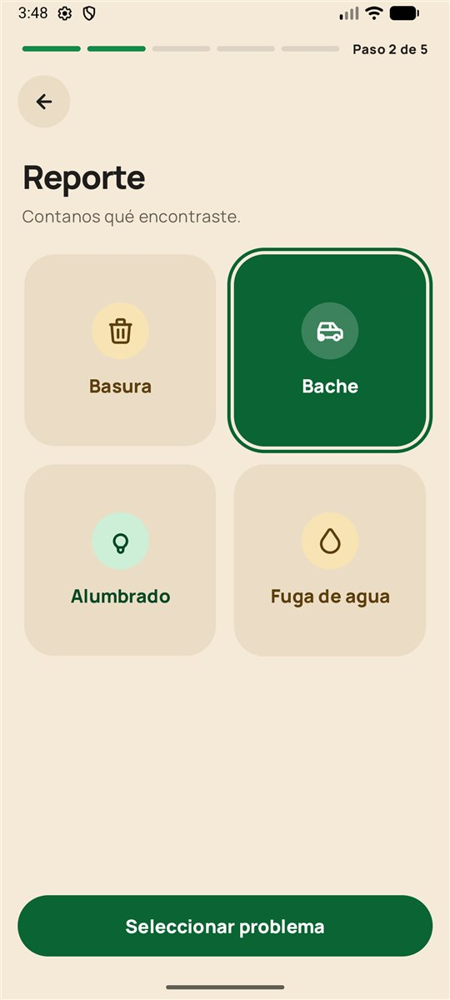<br><sub><b>2 · Tipo de problema</b></sub></td>
    <td align="center">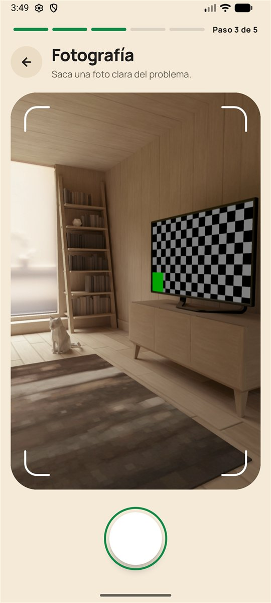<br><sub><b>3 · Fotografía</b></sub></td>
    <td align="center">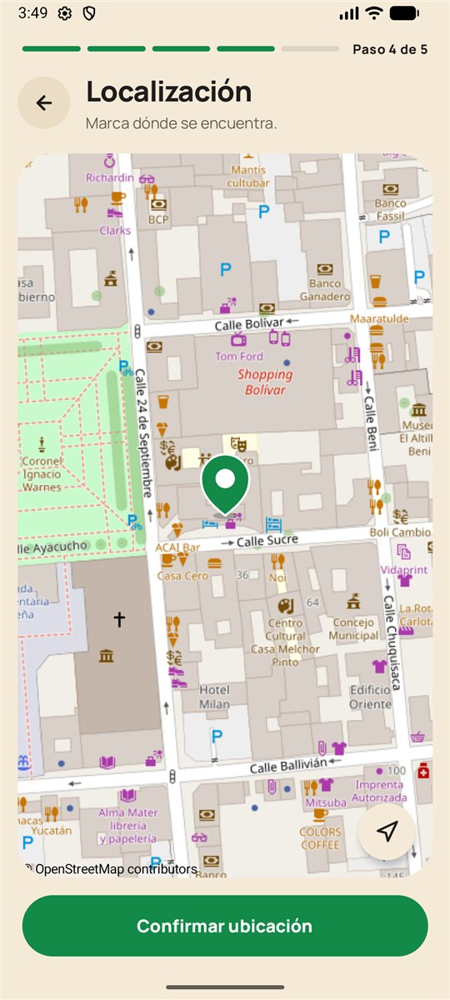<br><sub><b>4 · Localización</b></sub></td>
    <td align="center">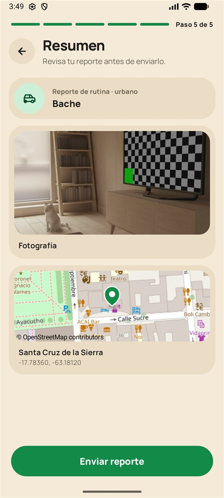<br><sub><b>5 · Resumen</b></sub></td>
  </tr>
</table>

<table>
  <tr>
    <td align="center">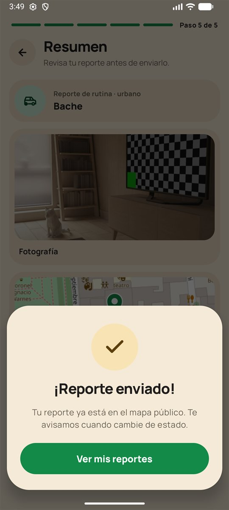<br><sub><b>¡Reporte enviado!</b></sub></td>
    <td align="center">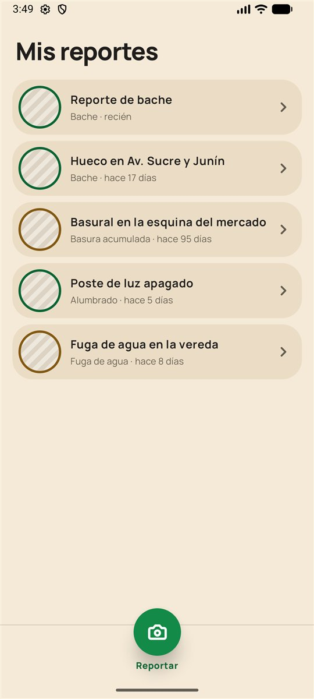<br><sub><b>El reporte aparece en la lista</b></sub></td>
  </tr>
</table>

---

## ✨ Funcionalidades

| | Pantalla | Qué hace |
|:---:|---|---|
| 🏛️ | **Bienvenida** | Presenta la app con el escudo de Santa Cruz y el lema. |
| 🔑 | **Login** | Usuario y contraseña. Según el rol lleva a **Mis reportes** (vecino) o al **panel del administrador** (por ahora, provisorio). La sesión queda guardada. |
| 📋 | **Mis reportes** | Lista de reportes con categoría y antigüedad ("recién", "hace 3 h", "hace 17 días"), con un color por familia: 🟢 urbano, 🟠 ambiental. |
| 🔍 | **Detalle** | Categoría, título, fecha y hora de envío, foto y ubicación del reporte. |
| 🚨 | **Paso 1 · Tipo** | Elegir entre **emergencia en curso** o **reporte de rutina**. |
| 🗂️ | **Paso 2 · Categoría** | Emergencias: incendio o humo. Rutina: basura, bache, alumbrado o fuga de agua. |
| 📷 | **Paso 3 · Fotografía** | Cámara dentro de la app (CameraX): visor con guías, destello, *Repetir* o *Usar foto*. |
| 📍 | **Paso 4 · Localización** | Toma la ubicación **GPS** del teléfono y la muestra en un mapa de OpenStreetMap. |
| ✅ | **Paso 5 · Resumen** | Revisa categoría, foto y mapa antes de enviar; confirma con el modal **¡Reporte enviado!** |

**Detalles que cuidamos**

- 🕐 **Hora de Bolivia automática**: cada reporte guarda el momento en que se creó y lo muestra en hora boliviana (`America/La_Paz`, UTC-4), aunque el teléfono esté en otra zona horaria.
- 🔐 **Permisos bien manejados**: la cámara y la ubicación se piden al llegar a su paso, con opción de reintentar o de ir a los ajustes si el usuario los bloqueó.
- 🧹 **Sin archivos huérfanos**: las fotos que no se usan (al repetir o al salir sin confirmar) se borran del teléfono.
- 📶 **Avisos útiles**: sin conexión, sin GPS o sin permiso, la pantalla lo explica en lugar de fallar.
- ♿ **Accesibilidad**: botones de al menos 48 dp, textos para lectores de pantalla y contraste revisado.
- ☀️ **Siempre en modo claro**, con la paleta propia de la marca (sin colores dinámicos del sistema).

---

## 🧭 Cómo funciona

### Navegación

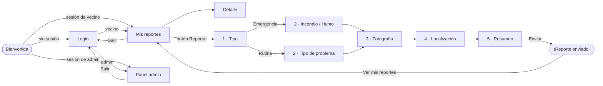

Todas las rutas viven en un único `NavHost` (`navigation/ReportaCiudadNavHost.kt`), con **rutas type-safe** (`navigation/Rutas.kt`). Las pantallas no navegan solas: reciben datos y *callbacks* (`onVolver`, `onSeleccionar`, `onFotoSacada`…) y el `NavHost` decide a dónde ir.

### Arquitectura

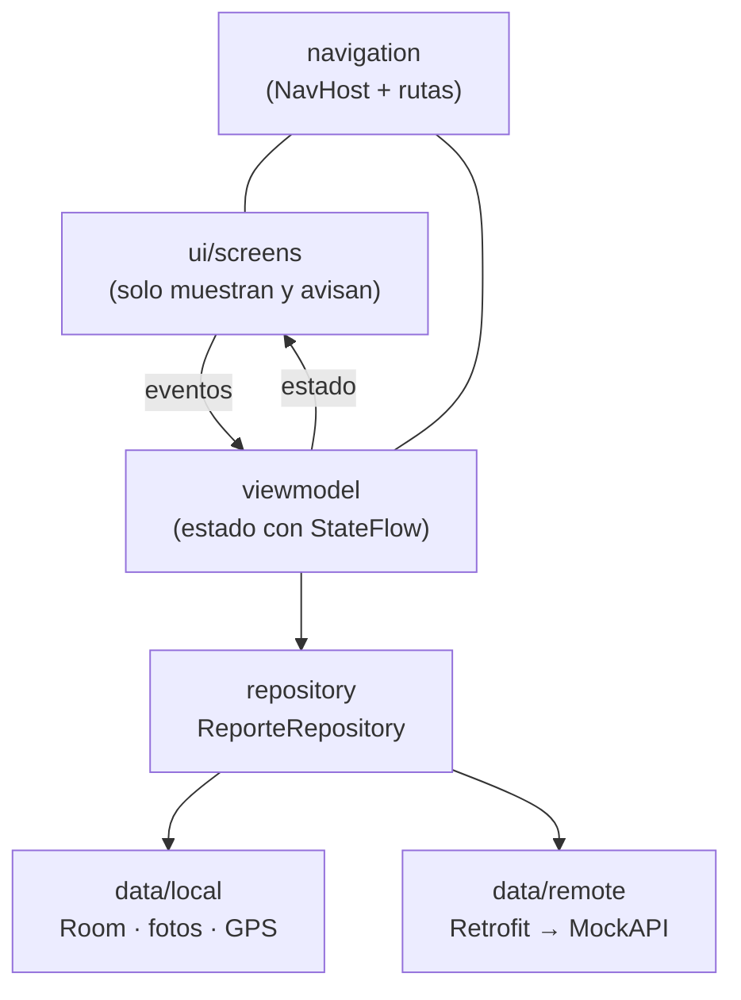

| Capa | Paquete | Responsabilidad |
|---|---|---|
| Interfaz | `ui/screens` | Dibujar el estado que reciben y avisar lo que hace el usuario. No conocen ViewModels, repositorios ni navegación. |
| Navegación | `navigation` | Conecta cada pantalla con su ViewModel y decide a dónde ir. |
| Presentación | `viewmodel` | Estado de cada pantalla (`StateFlow`) y operaciones: elegir categoría, foto, ubicación, enviar. |
| Repositorio | `repository` | Único acceso a los datos. Decide qué va al teléfono y qué al servidor. |
| Datos locales | `data/local` | Room (`reportes`), fotos en `files/fotos/` y ubicación GPS. |
| Datos remotos | `data/remote` | API de MockAPI con Retrofit (`POST /reportes`). |

Las dependencias se arman una sola vez en `AppContainer` (inyección manual) y los ViewModels se crean con `AppViewModelProvider`.

### El borrador del reporte

Mientras el usuario avanza por los pasos, sus respuestas se juntan en un `ReporteFormulario` dentro de **`ReporteFormularioViewModel`**. Ese ViewModel pertenece al subgrafo de navegación del flujo: lo comparten los 5 pasos, sobrevive a la rotación y se descarta al salir del flujo. Si el usuario sale sin enviar, borra la foto.

```
Paso 2  →  vm.elegirProblema(BACHE)
Paso 3  →  vm.fotoSacada(".../files/fotos/reporte_1790....jpg")
Paso 4  →  vm.buscarUbicacion()  →  vm.confirmarUbicacion()
Paso 5  →  vm.enviar()  →  repository.enviar(borrador)
```

### Envío: primero el teléfono, después el servidor

```
1. Room      INSERT con estado PENDIENTE   → aparece en Mis reportes al instante
2. MockAPI   POST /reportes                → devuelve el id del servidor
3. Room      estado ENVIADO (+ remoteId)   o   ERROR si no hubo conexión
```

Room es la **fuente de verdad**: la UI siempre lee de la base local. Los reportes que no se pudieron enviar se marcan *"sin enviar"* en la lista y se reintentan al volver a abrir la app.

**JSON del recurso `reportes`:**

```json
{
  "id": "1",
  "emergencia": null,
  "problema": "BACHE",
  "latitud": -17.7836,
  "longitud": -63.1812,
  "fechaHora": 1794500000000,
  "fotoUrl": null
}
```

`fechaHora` va en milisegundos UTC. Las fotos todavía no se suben (`fotoUrl` queda en `null`): se quedan en el teléfono.

### Inicio de sesión

La app busca al usuario en el recurso `usuarios` de MockAPI (`GET /usuarios?usuario=…`) y compara usuario y contraseña exactos. Si coinciden, guarda la sesión (sin la contraseña) con **DataStore**; la próxima vez que se abre la app entra directo a la pantalla de su rol.

**JSON del recurso `usuarios`:**

```json
{
  "id": "1",
  "usuario": "vecino1",
  "contrasena": "1234",
  "rol": "VECINO",
  "nombre": "Vecino de prueba"
}
```

`rol` es `VECINO` o `ADMIN`. ⚠️ Es un login **solo para la demo**: MockAPI es público y las contraseñas quedan en texto plano. No uses contraseñas reales.

---

## 🛠️ Tecnologías

| Área | Herramienta | Versión |
|---|---|---|
| Lenguaje | Kotlin | 2.2 |
| Interfaz | Jetpack Compose + Material 3 | BOM `2026.02.01` |
| Navegación | Navigation Compose (rutas type-safe) | 2.8.0 |
| Base de datos | Room + KSP | 2.8.3 |
| Red | Retrofit + kotlinx.serialization + OkHttp | 3.0.0 |
| Estado | ViewModel + StateFlow (Lifecycle) | 2.11.0 |
| Servidor | [MockAPI](https://mockapi.io) (API REST de prueba) | — |
| Cámara | CameraX (`camera-camera2`, `camera-lifecycle`, `camera-view`) | 1.6.2 |
| Imágenes | Coil | 3.4.0 |
| Mapas | osmdroid + tiles de OpenStreetMap | 6.1.20 |
| Ubicación | `LocationManager` de Android (sin Google Play Services) | — |
| Build | Gradle Kotlin DSL + catálogo de versiones, AGP | 9.3 |
| SDK | `minSdk 24` · `targetSdk 37` · `compileSdk 37` | — |

### Permisos

| Permiso | Para qué |
|---|---|
| `CAMERA` | Sacar la foto del problema (paso 3). |
| `ACCESS_FINE_LOCATION` / `ACCESS_COARSE_LOCATION` | Guardar dónde está el problema (paso 4). |
| `INTERNET` / `ACCESS_NETWORK_STATE` | Enviar los reportes, descargar el mapa y avisar cuando no hay conexión. |

---

## 🗂️ Estructura del proyecto

```
app/src/main/java/com/example/reportaciudad/
├── MainActivity.kt                    # Punto de entrada: tema y barras del sistema
├── ReportaCiudadApp.kt                # Application: crea el AppContainer
├── AppContainer.kt                    # Inyección de dependencias manual
├── data/
│   ├── model/                         # Reporte, ReporteFormulario, TipoProblema, TipoEmergencia, Ubicacion, Sesion
│   ├── local/
│   │   ├── db/                        # Room: ReporteEntity, ReporteDao, ReportaCiudadDatabase
│   │   ├── ReporteMapper.kt           # ReporteEntity → Reporte
│   │   ├── AlmacenFotos.kt            # Fotos en files/fotos/
│   │   ├── SesionStore.kt             # Sesión guardada con DataStore
│   │   └── UbicacionActual.kt         # GPS / red
│   └── remote/
│       ├── ReporteApi.kt              # Endpoints de MockAPI (Retrofit)
│       ├── ReporteDto.kt              # JSON del recurso "reportes"
│       ├── UsuarioApi.kt              # GET /usuarios para el login
│       ├── UsuarioDto.kt              # JSON del recurso "usuarios"
│       ├── ClienteApi.kt              # Retrofit + OkHttp (uno para toda la app)
│       ├── ReporteRemoteDataSource.kt # Interfaces de las fuentes remotas
│       ├── UsuarioRemoteDataSource.kt
│       ├── RetrofitReporteRemoteDataSource.kt
│       └── RetrofitUsuarioRemoteDataSource.kt
├── repository/                        # ReporteRepository y AuthRepository (+ Impl)
├── viewmodel/                         # Reportes, Detalle, ReporteFormulario, Login y Sesion ViewModels
├── navigation/                        # Rutas type-safe + ReportaCiudadNavHost
├── util/                              # FechaBolivia: fechas en hora de Bolivia
└── ui/
    ├── screens/
    │   ├── bienvenida/
    │   ├── login/
    │   ├── admin/                     # Panel del administrador (provisorio)
    │   ├── componentes/               # BotonSalir
    │   ├── inicio/                    # Mis reportes
    │   ├── detalle/
    │   └── reportar/
    │       ├── componentes/           # PasoReporte, BarraProgreso, tarjetas y botones comunes
    │       ├── tipo/                  # Paso 1
    │       ├── emergencia/            # Paso 2 (emergencia)
    │       ├── problema/              # Paso 2 (rutina)
    │       ├── fotografia/            # Paso 3 + VisorCamara (CameraX)
    │       ├── localizacion/          # Paso 4 + mapa
    │       └── resumen/               # Paso 5 + modal de enviado
    └── theme/                         # Colores, tipografía y tema
```

El esquema de la base se exporta a `app/schemas/` para versionar las migraciones.

---

## 🎨 Sistema de diseño

Una paleta cálida, de tonos tierra, pensada para la ciudad.

| | Color | Hex | Uso |
|:---:|---|---|---|
|  | **Urbano** | `#138A48` | Color principal, botones, familia urbana |
|  | **Ambiental** | `#B8801F` | Familia ambiental |
|  | **Emergencia** | `#9B2C24` | Emergencias en curso |
|  | **Fondo** | `#F5EAD8` | Fondo de las pantallas |
|  | **Superficie** | `#EBDDC5` | Tarjetas y botones secundarios |
|  | **Texto** | `#201E1D` | Texto principal |

**Tipografía:** [Manrope](https://fonts.google.com/specimen/Manrope), con **800** para títulos y botones y **400** para el texto. Los íconos son vectores propios, dibujados con `ImageVector`.

---

## 🚀 Cómo ejecutarla

### Requisitos

- [Android Studio](https://developer.android.com/studio) reciente (compatible con AGP 9.3)
- JDK 11 o superior (sirve el que trae Android Studio)
- Celular o emulador con **Android 7.0 (API 24)** o superior

### Pasos

```bash
git clone https://github.com/nicosnz/reporta-ciudad.git
```

1. Abre la carpeta en Android Studio y espera a que termine la sincronización de Gradle.
2. Elige un dispositivo y presiona **Run ▶**.

Desde la terminal:

```bash
./gradlew assembleDebug    # genera app/build/outputs/apk/debug/app-debug.apk
./gradlew installDebug     # lo instala en el dispositivo conectado
```

La URL del servidor está en `app/build.gradle.kts` (`API_BASE_URL`).

### Probar la cámara y el GPS en el emulador

- **Cámara**: en el *Device Manager*, configura la cámara trasera como **VirtualScene** o **Webcam**.
- **Ubicación**: envía una posición de Santa Cruz al emulador:
  ```bash
  adb emu geo fix -63.1812 -17.7836
  ```

---

## 📌 Estado actual

La app guarda los reportes en el teléfono con **Room** y los envía a un servidor de prueba en **MockAPI**. Por ahora:

- **Las fotos no se suben al servidor**: MockAPI solo guarda JSON. Se quedan en el teléfono y `fotoUrl` va en `null`.
- **MockAPI es público**: cualquiera con la URL puede leer los reportes (incluidas las coordenadas). Sirve para pruebas y demos, no para datos reales de vecinos.
- Los reportes sin enviar se reintentan **al abrir la app**, todavía no en segundo plano.
- **Mis reportes muestra los reportes de este teléfono**, no los del usuario: los reportes no guardan quién los envió. Si dos vecinos usan el mismo celular ven los mismos reportes, y en un celular nuevo la lista empieza vacía. Cerrar sesión no borra la lista (se perderían los que no se enviaron).
- El **panel del administrador** es provisorio: todavía no lista ni gestiona reportes.
- La ubicación es la **posición actual del teléfono**; el lugar se guarda como coordenadas, todavía sin nombre de calle.
- Los mapas usan los servidores comunitarios de OpenStreetMap: adecuados para pruebas y demos, no para muchos usuarios.

---

## 🎯 Hoja de ruta

**Etapa 1 — prototipo** ✅

- [x] Bienvenida, Mis reportes y Detalle
- [x] Flujo de 5 pasos para reportar
- [x] Cámara dentro de la app
- [x] Ubicación por GPS con mapa
- [x] Resumen y confirmación de envío
- [x] Fecha y hora de Bolivia automáticas

**Etapa 2 — datos y arquitectura** ✅

- [x] Reportes guardados en el teléfono con Room
- [x] Envío a un servidor (MockAPI) con Retrofit, con reintento si no hay conexión
- [x] Arquitectura en capas: `ui` · `navigation` · `viewmodel` · `repository` · `data/local` · `data/remote`

**Etapa 3 — usuarios** 🚧

- [x] Login con usuario y contraseña (MockAPI) y sesión guardada con DataStore
- [x] Navegación por rol: vecino → Mis reportes, admin → panel
- [ ] Panel del administrador: listar, revisar, asignar, resolver y rechazar reportes
- [ ] Guardar en cada reporte quién lo envió

**Próximas etapas**

- [ ] Subir las fotos a un servicio de archivos y guardar su URL
- [ ] Reintentar los envíos en segundo plano (WorkManager)
- [ ] Estados del reporte: Recibido, Visto, Asignado, Resuelto
- [ ] Nombre de la calle a partir de las coordenadas
- [ ] Mostrar la foto real en la lista de Mis reportes
- [ ] Alertas de incendio por niveles

---

## 🤝 Contribuir

1. Crea una rama desde `main`: `feat/…` para funcionalidades o `fix/…` para correcciones.
2. Escribe commits descriptivos en español: `feat: …`, `fix: …`, `chore: …`.
3. Abre un Pull Request hacia `main`.

## 👥 Equipo

Hecho en Santa Cruz de la Sierra por **Emanuel Oly** y **linuxenthusiastic**.

## 📄 Créditos

- Mapas: © [OpenStreetMap](https://www.openstreetmap.org/copyright) contributors.
- Tipografía: [Manrope](https://fonts.google.com/specimen/Manrope), bajo licencia SIL Open Font License.
- Escudo de Santa Cruz de la Sierra: símbolo oficial del municipio.
